# Trace.Space CI example: VanLife autonomy stack

A small TypeScript autonomy stack (perception, planning, safety) wired to a Trace.Space org with
GitHub Actions. It's a worked example of a software engineering integration, built against a demo
org called **VanLife** (one vehicle platform, three variants: Sedan, SUV, Van).

It isn't a drop-in kit. It shows what's possible, and [docs/REPRODUCING.md](docs/REPRODUCING.md)
explains how to build the same thing in your own org with your own scripts.

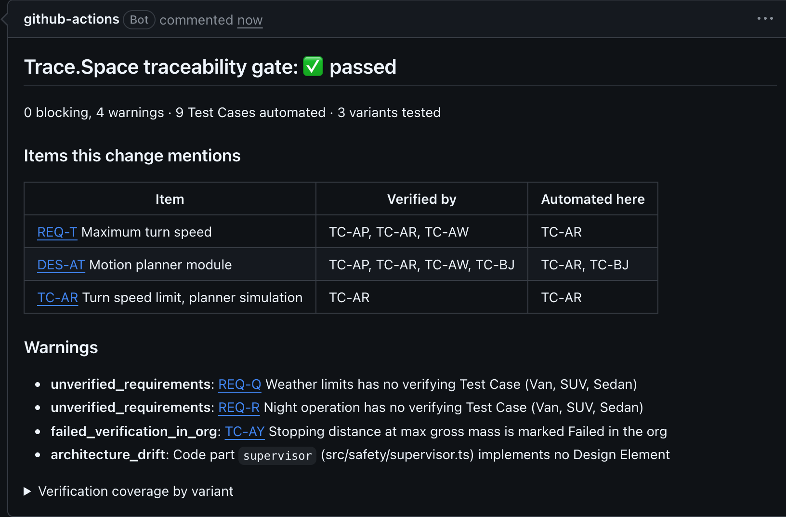

## Why this approach

Requirements, design and verification live in Trace.Space. Code, tests and builds live in Git and CI.
Usually the two drift apart, and the gap is closed by hand before a review or an audit. Here the
pipeline closes it on every push:

- **One source of truth for numbers.** Limits such as the maximum turn speed are parameters in
  Trace.Space, pinned per variant. CI pulls them into the code before testing, so nobody copies a value
  by hand, and a change in the org is tested on the next build.
- **Evidence without paperwork.** Automated tests record their results as Test Runs against the exact
  Test Case versions each variant pins. The verification record builds itself.
- **Traceability checked like code.** A gate runs on every pull request and says, in the PR, which
  requirements a change touches, which tests cover them and what's missing. Gaps are found while the
  change is open, not at the next review.
- **Diagrams that can't go stale.** The architecture diagrams are generated, and the code-side model is
  checked against the source on every push. The org's design is cross-checked against the code, so
  code that implements no Design Element, or a Design Element with no code, shows up immediately.
- **Two-way navigation.** Item IDs in commits and PRs become links on the items; with links on,
  every box in the diagrams links back to its item. From either side, you're one click from the other.
- **Safe to run constantly.** CI never edits items. Test Runs, step results and comments sit beside them,
  so nothing becomes suspect and no baseline is disturbed, however often the pipeline runs.
- **Plain building blocks.** About 1,500 lines of dependency-free Node against the public REST API,
  plus a standard GitHub Actions workflow. Nothing to install in the org.

## What the integration produces

Screenshots are from a real run of this repository against the demo org: a pull request and the
push to `main` that merged it. User names and emails in the Trace.Space screenshots are blurred.

### 1. A pipeline that knows about variants

One test job per vehicle variant, then a `trace` job that talks to Trace.Space. Each variant's tests run
against that variant's parameters, pulled from the org (`config/params.<variant>.json`).

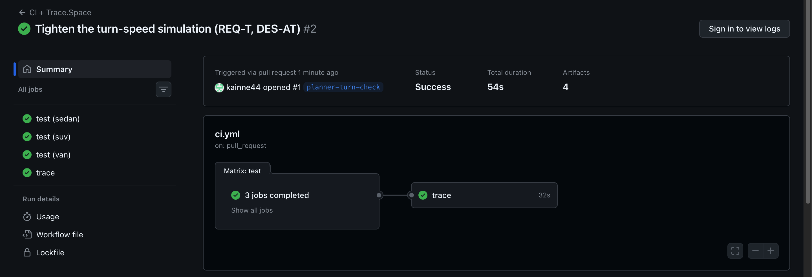

> [!TIP]
> **Why it matters:** the Van has a different turn-speed limit and braking distance than the Sedan.
> Testing each variant against its own values in the org catches a code path that only fails for one
> of them, and a parameter change in Trace.Space reaches the tests without anyone editing code.

### 2. The traceability gate, in the pull request

`trace/gate.mjs` checks the change against the org and posts its report as a PR comment (updated in
place on every push) and in the job summary. It lists the items the change mentions, the Test Cases
behind them and which of those this repository automates, then any findings. Each check is
`fail`, `warn` or `off` in [`trace/policy.json`](trace/policy.json).

| Check | Fails or warns when |
|---|---|
| `unknown_test_tags` | a test is tagged with an ID that isn't a Test Case |
| `failing_tests` | a tagged test failed in this build |
| `suspect_traces` | a trace points at an outdated item version |
| `unverified_requirements` | a requirement in a variant has no verifying Test Case |
| `failed_verification_in_org` | a Test Case's latest result in the org is Failed |
| `param_drift` | committed parameter files differ from the org |
| `untraced_ids_in_change` | the change mentions an ID that isn't in the org |
| `architecture_drift` | the code and the org's design disagree (see 6) |

The screenshot at the top of this page is the gate on that pull request: it passed, with four warnings.

> [!TIP]
> **Why it matters:** reviewers see the impact of a change on requirements and verification without
> leaving GitHub, and the policy file makes the rules explicit and reviewable. Start with warnings,
> then tighten checks to `fail` as the project matures.

### 3. Test results become Test Runs

Tests are named after the Test Case they automate (`test("TC-AR Turn speed limit, planner simulation", …)`).
On each push to `main`, every variant's results become a Test Run. The steps and expected results
come from the Test Case in Trace.Space, as written by the test engineer:

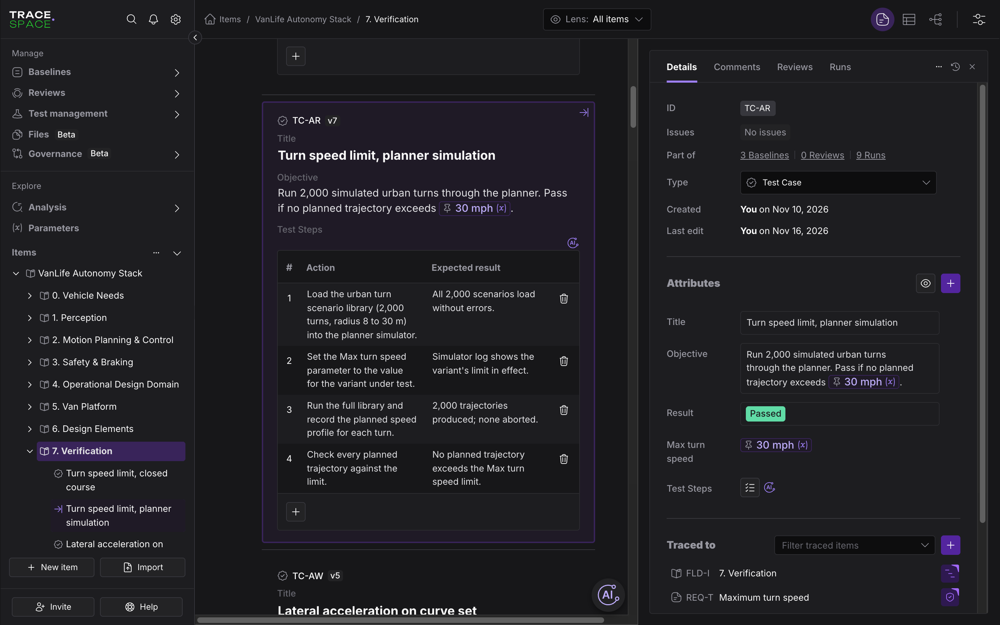

CI records each step's result, and the last step's actual result carries the evidence: test name,
outcome and duration, or the failure message.

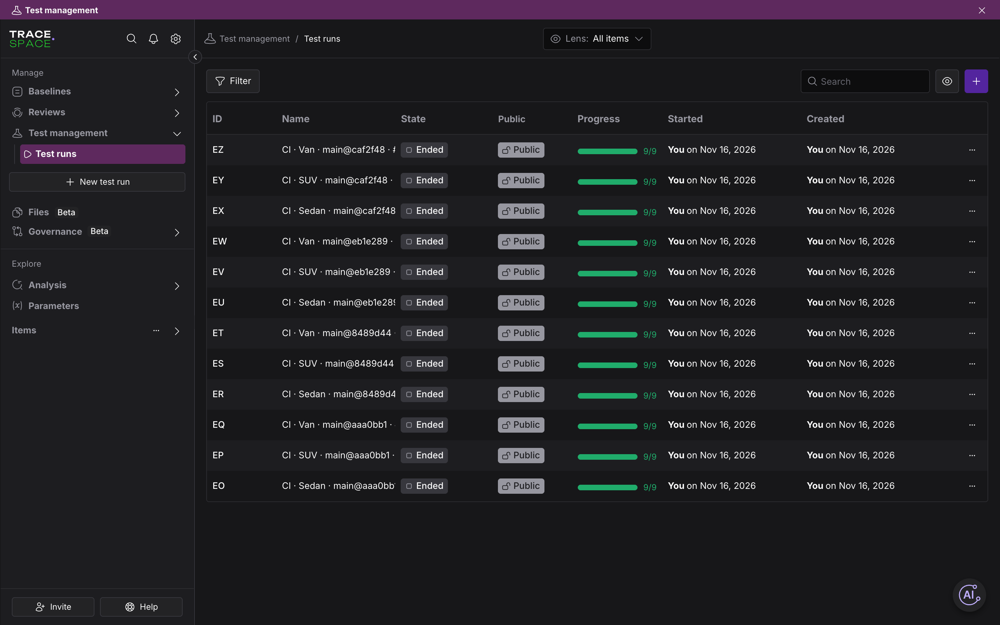

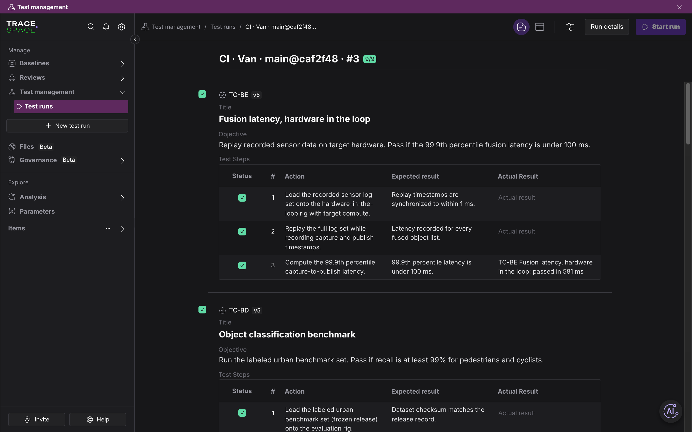

The run's details record where the evidence came from: source, commit, build URL, variant and branch.

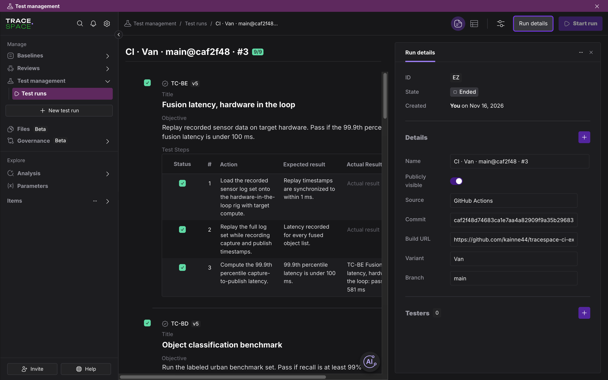

> [!TIP]
> **Why it matters:** automated verification shows up in the same place as manual verification, against
> the Test Case version each variant pins, with a link back to the exact build. Coverage and results
> reports in Trace.Space include it automatically.

### 4. Commits and pull requests linked on the items

Item IDs in a commit message, PR title or PR body (`REQ-T`, `DES-AT`, `TC-AR`) become a comment on
the item linking back to GitHub. Re-running is safe; an item gets one comment per PR or commit.

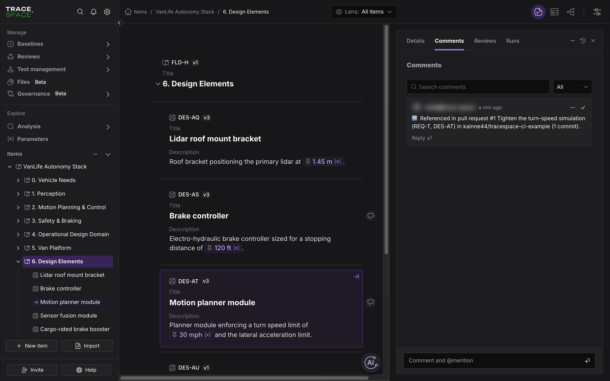

> [!TIP]
> **Why it matters:** anyone looking at a requirement or design element in Trace.Space can see which
> code changes touched it, without access to the repository's history or a separate tool.
> Comments don't change the item's version, so this never makes traces suspect.

### 5. Architecture diagrams generated from the code

`model/autonomy-stack.model.json` describes the code's structure as data: parts, typed ports, the data
that crosses them, and the main behaviors. [`tools/code-model.mjs`](tools/code-model.mjs), one
dependency-free script, does two things with it:

- `npm run model:check` verifies the model against the TypeScript: symbols exist, fields and enum
  values match, interfaces have the same operations and signatures, classes implement the ports they
  provide. CI runs it on every push and fails if they disagree.
- `npm run model:render` writes `docs/architecture/autonomy-stack.drawio`: the internal block diagram,
  the interfaces, and one page per behavior, all cross-linked. Each part is labeled with the Design
  Element it implements (a link to the item when links are on).

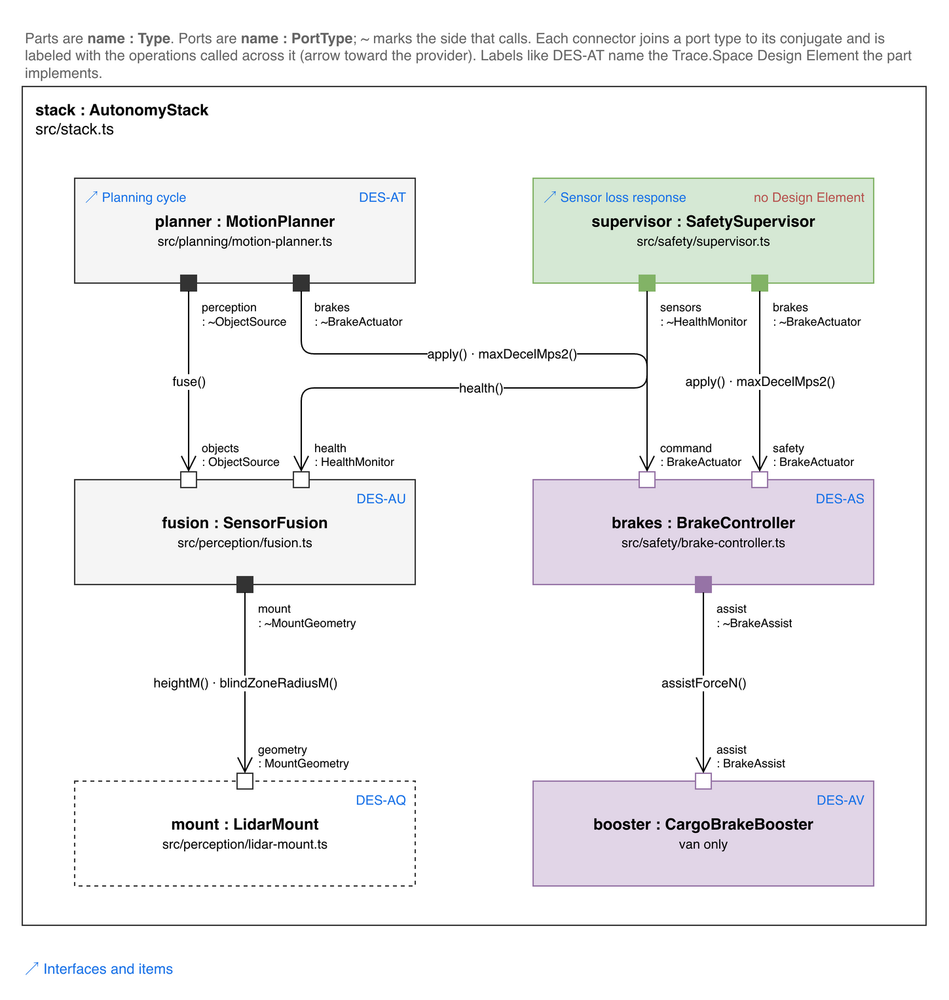

The planner's behavior, one click from the planner part:

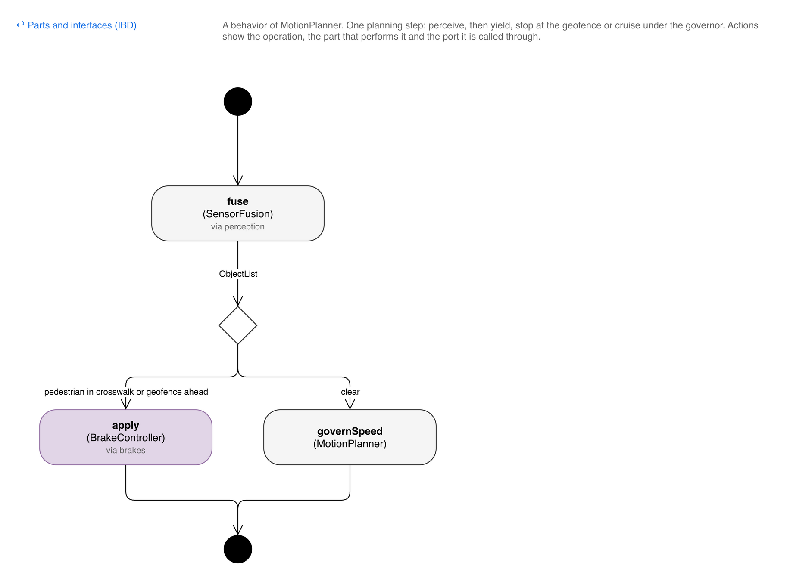

> [!TIP]
> **Why it matters:** a hand-drawn diagram is out of date the week after it's drawn. This one is
> checked against the code on every push, stays editable in draw.io, and connects each part to its
> design element, requirements and tests in Trace.Space.

### 6. The org's design, cross-checked against the code

`trace/diagrams.mjs` draws the architecture as Trace.Space describes it: each Design Element, the
requirements it satisfies and their Test Cases, colored by the latest CI result
(`docs/architecture/tracespace-allocation.drawio`). With links on, every box opens its item.

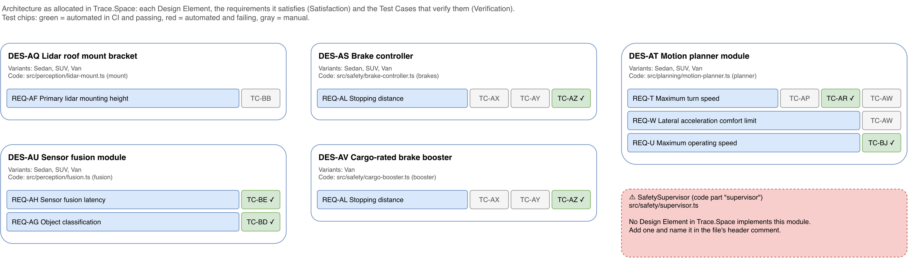

A second page compares it with the code model. A source file names the Design Element it implements in
its header comment (`// Motion planner module (DES-AT): …`).

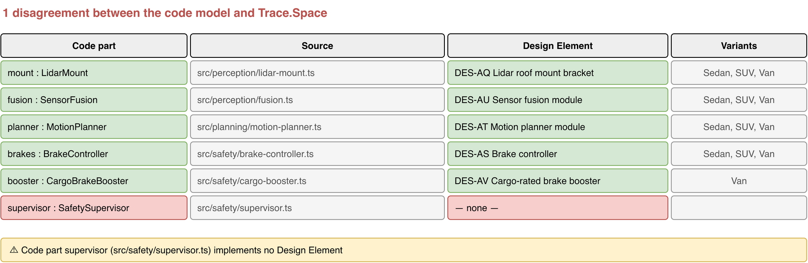

> [!TIP]
> **Why it matters:** this found a real gap in the demo: `src/safety/supervisor.ts`, the module that
> brings the vehicle to a safe stop when a sensor fails, exists in the code but has no Design Element in
> the org. Its behavior is untraced to any requirement. The gate reports it as `architecture_drift`.

## Run it locally

```sh
npm ci
node trace/run-tests.mjs --all       # works offline, against the committed config/params.*.json
npm run model:check                  # works offline: the architecture model against the code

# With an Integration client of your org in .env (gitignored):
#   TRACESPACE_CLIENT_ID=…  TRACESPACE_CLIENT_SECRET=…
#   TRACESPACE_URL=…        the address you open Trace.Space at (see "Finding your Trace.Space address")
npm run trace:params                 # refresh config/params.*.json from the org
node trace/run-tests.mjs --all       # test every variant -> results/<variant>.json
npm run model:render -- --png --tracespace   # code diagrams, parts linked to Design Elements
npm run diagrams -- --png            # org diagram + cross-check (PNGs need DRAWIO=<draw.io binary>)
npm run trace:gate                   # results/gate.md
node trace/push-results.mjs --dry-run
node trace/link.mjs --dry-run        # item IDs in the last commit
```

## CI setup

Without secrets, CI typechecks, checks the architecture model and tests every variant against the
committed parameters, and skips every Trace.Space step. To connect it, add three repository secrets:

| Secret | Value |
|---|---|
| `TRACESPACE_CLIENT_ID`, `TRACESPACE_CLIENT_SECRET` | an Integration client of your org |
| `TRACESPACE_URL` | your Trace.Space address (below) |

Only the steps that call Trace.Space receive them, and GitHub masks secret values in logs. The scripts
expect an org shaped like VanLife; see the guide, section 8, for what to adapt.

### Finding your Trace.Space address

Open Trace.Space in your browser and copy the address from the address bar. Any page works, including
a link to an item; the scripts keep just the host (and your org, if the link contains it) and derive
the API address from it by putting `api.` in front of the host. If your organization's API lives
somewhere else, set `TRACESPACE_API_BASE` too; your Trace.Space administrator can tell you.

This repository never names a host itself, so it works whichever Trace.Space address your org uses.

### Links in public output

Gate comments and generated diagrams can link every item ID to the item in Trace.Space. Those links
contain your Trace.Space host and org ID, and a PR comment on a public repository is public (GitHub
doesn't mask secrets inside comments). So the workflow defaults to plain IDs: `TRACESPACE_LINKS=ids`.
In a private repository, set the repository variable `TRACESPACE_LINKS` to `on` for clickable links.
Comments the pipeline posts on items inside Trace.Space always link to GitHub; only your org sees them.

## Layout

```text
src/                 the stack: perception/, planning/, safety/, stack.ts, config/params.ts
test/                node:test suites; names start with a Test Case ID when they automate one
config/              per-variant parameter values pulled from Trace.Space
model/               architecture model of src/ (checked and drawn by tools/code-model.mjs)
tools/               code-model.mjs: check the model against the code, render it to draw.io
trace/               the integration: lib/, pull-params, run-tests, push-results, gate, link, diagrams, policy.json
docs/                REPRODUCING.md (the guide), architecture/ (generated), screenshots/
```

## License

MIT. See [LICENSE](LICENSE).
